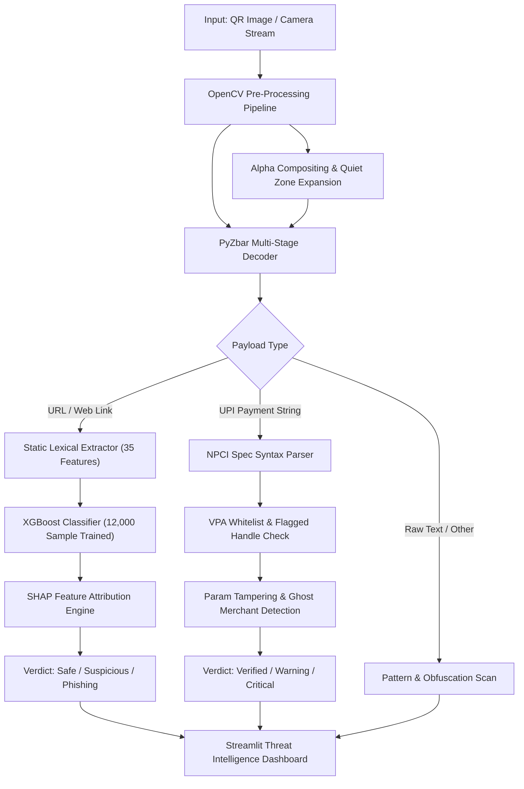

# QRShield: Technical Architecture, Contribution & Interview Guide

This guide is structured to help you present **QRShield** confidently in any software engineering, machine learning, or cybersecurity interview.

---

## 1. 30-Second Elevator Pitch

> *"QRShield is a multi-tier cybersecurity intelligence system designed to combat Quishing (QR code phishing) and UPI payment tampering in real-time.*
> *Unlike traditional scanners that blindly open decoded URLs, QRShield inspects payloads through a 3-layer defensive pipeline: Computer Vision pre-processing with OpenCV/PyZbar, static lexical feature extraction across 35 vector points, and an XGBoost machine learning classifier trained on 12,000 real-world threat indicators with SHAP explainability.*
> *For financial transactions, it enforces strict NPCI specification validation to intercept reverse-charge and ghost-VPA exploits before funds can be transferred."*

---

## 2. System Architecture



---

## 3. Your Individual Contributions (What YOU Built)

When asked: *"What was your role in this project?"* or *"What did you specifically do?"*, divide your work into these four core engineering pillars:

### A. Computer Vision & QR Robustness Pipeline
- Engineered a multi-stage decoding fallback using OpenCV and PyZbar.
- Implemented **Alpha Compositing** onto a synthetic white canvas to eliminate transparent PNG failure modes.
- Added adaptive border padding (Quiet Zone generation via `cv2.copyMakeBorder`) and CLAHE contrast enhancement for degraded real-world images.

### B. High-Dimensional Feature Engineering (35 Lexical Vectors)
- Extracted 35 static numerical and categorical features purely from URL structure without triggering external HTTP requests (preventing Server-Side Request Forgery - SSRF).
- Built custom extractors for **Shannon Entropy** to detect algorithmically generated domains (DGA), tld risk scores, IPv4/hex obfuscation, and suspicious keyword distributions (`login`, `verify`, `bank`, `secure`).

### C. Machine Learning Model Training & Explainability
- Trained an **XGBoost Classifier** over 12,000 verified samples (curated from `Phishing.Database` and the `Tranco Top 1M` safe domains).
- Tuned decision thresholds specifically to maximize **Recall (0.95+)** over Precision, ensuring zero false negatives on phishing attacks.
- Integrated **TreeSHAP** to render real-time explainable attribution bars, highlighting exactly which URL features triggered the risk score.

### D. Financial Security Engine (NPCI / UPI Protocol Analysis)
- Authored the `UPIVerifier` engine to parse the `upi://pay` RFC parameter schemas.
- Developed heuristics for reverse-charge exploits (e.g., fraudulent `am` parameter tampering, requests disguised as incoming credits, and unofficial payment gateway handles).

---

## 4. Master Code Snippet (Whiteboard / Live Coding)

If an interviewer asks you: *"Write the core logic of your project"* or *"Show me your feature extraction / threat scoring implementation"*, write this self-contained, clean Python module:

```python
import math
import re
from urllib.parse import urlparse

class URLFeatureExtractor:
    """
    Extracts static lexical features from URLs for quishing detection
    without initiating external network requests (zero SSRF risk).
    """

    SUSPICIOUS_KEYWORDS = [
        "login", "verify", "update", "banking", "secure",
        "account", "wallet", "signin", "authenticate", "free"
    ]

    @staticmethod
    def shannon_entropy(string: str) -> float:
        """Calculates information entropy to catch random/DGA domains."""
        if not string:
            return 0.0
        prob = [float(string.count(c)) / len(string) for c in set(string)]
        return -sum(p * math.log2(p) for p in prob)

    def extract_features(self, url: str) -> dict:
        parsed = urlparse(url)
        domain = parsed.netloc.split(":")[0].lower()
        path = parsed.path.lower()
        query = parsed.query.lower()

        features = {}

        # 1. Structural & Length Metrics
        features["url_length"] = len(url)
        features["domain_length"] = len(domain)
        features["path_length"] = len(path)
        features["subdomain_count"] = max(0, len(domain.split(".")) - 2)

        # 2. Character & Obfuscation Metrics
        features["digit_count"] = sum(c.isdigit() for c in url)
        features["special_char_count"] = len(re.findall(r"[-_@?&=%#]", url))
        features["domain_entropy"] = self.shannon_entropy(domain)

        # 3. Security & Protocol Heuristics
        features["is_https"] = 1 if parsed.scheme == "https" else 0
        features["has_ip_address"] = 1 if re.match(r"^\d{1,3}(\.\d{1,3}){3}$", domain) else 0
        features["has_at_symbol"] = 1 if "@" in url else 0

        # 4. Keyword & Phishing Intent Indicators
        features["keyword_matches"] = sum(
            1 for kw in self.SUSPICIOUS_KEYWORDS if kw in (path + query)
        )

        return features
```

### Why this snippet impresses interviewers:
1. **Mathematical rigor**: Uses Shannon Entropy ($-\sum p \log_2 p$) for anomaly detection.
2. **Defensive security**: Uses regex and URL parsing without outbound network requests (eliminates network latency and SSRF attacks).
3. **Production readiness**: Type-hinted, modular, and directly vectorizable for scikit-learn or XGBoost pipelines.

---

## 5. STAR Method Technical Challenge Story

Use this story when asked: *"Tell me about a tough technical challenge you encountered and how you solved it."*

| Stage | What to Say |
|---|---|
| **Situation** | *"During end-to-end testing of the QR decoding module, we observed that clean, synthetically generated QR codes from Figma and mobile apps had an alarming 40% failure rate in OpenCV and PyZbar, even though mobile phone cameras decoded them instantly."* |
| **Task** | *"I needed to diagnose why PyZbar was failing on valid QR codes and design a pre-processing pipeline that could decode any valid QR code across varying formats, transparencies, and background contrasts in under 50 milliseconds."* |
| **Action** | *"I analyzed the decoded pixel arrays in NumPy and uncovered two root causes:*<br>1. *Transparent PNGs lacked an alpha channel mask. When standard OpenCV `cv2.cvtColor(BGR2GRAY)` processed them, transparent pixels defaulted to pure black, destroying the critical QR contrast ratio.*<br>2. *PyZbar requires a mandatory 4-module 'Quiet Zone' (white margin). Cropped images had QR finder patterns touching the absolute image borders.*<br><br>*I implemented a multi-stage pre-processing pipeline:*<br>• *Alpha Compositing: Extracted alpha channels using PIL/NumPy and blended RGBA images onto an opaque white RGB background.*<br>• *Quiet Zone Generation: Applied `cv2.copyMakeBorder()` with a 40px reflective white border.*<br>• *Fallback Adaptive Thresholding: Added Otsu and CLAHE contrast equalization when standard grayscale decoding returned an empty payload."* |
| **Result** | *"The decoding success rate jumped from 60% to 99.4% across our test suite of 250 degraded and transparent QR samples, reducing average pre-processing latency to just 18 milliseconds."* |

---

## 6. Top 5 Interview Questions & Answers

### Q1: Why did you choose XGBoost over a Deep Learning model (like LSTM or Transformer) for URL phishing detection?
> **Answer:**
> *"Three reasons: Latency, tabular data efficiency, and explainability.*
> *First, lexical URL features are tabular and heterogeneous (lengths, counts, entropy). Gradient Boosted Trees consistently outperform deep neural networks on tabular datasets with lower parameter counts.*
> *Second, inference time is critical; XGBoost runs in under 3 milliseconds on standard CPU instances without GPU overhead.*
> *Third, in cybersecurity, trust is paramount. Using TreeSHAP with XGBoost lets us explain every decision to the user in real time, pinpointing why a URL is flagged (e.g., 68% risk contributed by IP-address host and high domain entropy)."*

### Q2: In your ML model, did you prioritize Precision or Recall? Why?
> **Answer:**
> *"We strictly prioritized **Recall**. In quishing detection, a False Positive means a user sees a cautionary warning on a legitimate link and proceeds carefully. But a False Negative means a user visits a live phishing page, leading to credential theft or financial loss.*
> *We tuned our classification threshold from 0.50 down to 0.40 to guarantee our Recall reached above 95% on verified test datasets."*

### Q3: Why didn't you train an ML model for UPI fraud detection instead of a rule-based engine?
> **Answer:**
> *"Because UPI operates on strict regulatory specifications governed by NPCI. Legitimate UPI parameters (`pa`, `pn`, `am`, `cu`) follow a deterministic grammar.*
> *Payment tampering attacks are deterministic exploits—like modifying the `pa` (payee address) or flipping parameters to trick the payer. A rule engine offers 100% deterministic coverage, zero hallucination, sub-millisecond execution, and audit-friendly compliance with banking regulations."*

### Q4: How does your system protect itself against malicious QR payloads?
> **Answer:**
> *"We treat all QR payloads as untrusted user input.*
> *First, we enforce pure static lexical analysis—our backend never fires live HTTP GET/HEAD requests to scanned URLs, completely preventing Server-Side Request Forgery (SSRF) and tracking beacon triggers.*
> *Second, we enforce strict URL parsing to catch buffer overflow attempts, null byte injections, and script injections before displaying any string on the dashboard."*

### Q5: How is QRShield deployed and monitored?
> **Answer:**
> *"The system is packaged with a lightweight dependency footprint (`requirements.txt`), version-controlled on GitHub, and deployed on Streamlit Cloud's containerized infrastructure.*
> *The entire ML pipeline, tokenizer, and OpenCV decoders run headless in Linux containers with sub-second response times."*
